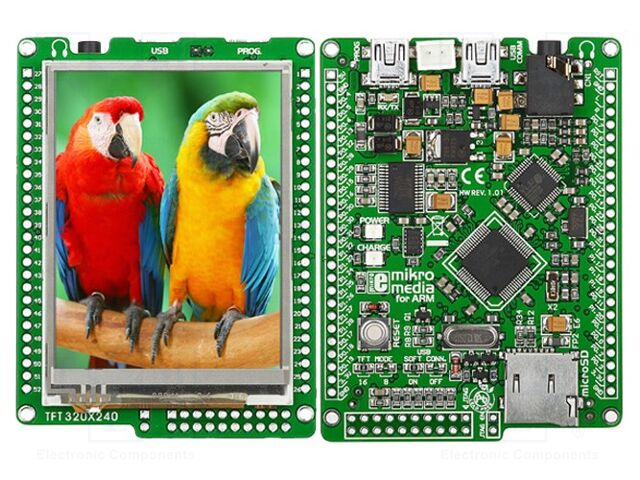

# mikromedia for ARM (LPC2148) Demo

Demonstration and board support package for the **mikromedia for ARM** development board by [MikroElektronika (MIKROE)](https://www.mikroe.com/).



---

## Hardware Overview

- **Board Name**: mikromedia for ARM (LPC2148)
- **Product ID / PID**: MIKROE-780
- **Product Reference**: [TME MIKROE-780 Catalog Entry](https://www.tme.eu/en/details/mikroe-780/other-development-tools/mikroelektronika/)
- **Manufacturer**: MikroElektronika (MIKROE)
- **Lifecycle Status**: **Discontinued / Legacy (End-of-Life)**. The legacy ARM7TDMI-S series has been superseded by newer ARM Cortex-M based mikromedia boards.
- **Microcontroller**: NXP **LPC2148**
  - **Core**: ARM7TDMI-S (32-bit RISC) @ up to 60 MHz
  - **Flash**: 512 KB (500 KB usable for user code, top sectors reserved for bootloader/IAP)
  - **SRAM**: 32 KB internal RAM + 8 KB USB RAM
- **Onboard Peripherals**:
  - **Display**: 320x240 TFT color display with resistive touch panel (`HX8347` / compatible driver)
  - **Audio Codec**: VS1053 MP3 / audio decoder with 3.5 mm stereo audio jack
  - **Accelerometer**: Analog Devices ADXL345 3-axis accelerometer (I2C)
  - **Storage**: MicroSD / MMC card slot (SPI) with FAT16/FAT32 file system support
  - **USB**: Full-speed USB 2.0 interface
  - **Power Management**: Li-Polymer battery connector with onboard charging circuit

---

## Project Structure

```
├── CMakeLists.txt              # Top-level CMake build configuration
├── build.sh                    # Helper script for building Debug/Release
├── cmake/
│   ├── arm-none-eabi.cmake     # CMake cross-compilation toolchain file
│   ├── lpc2148.ld              # GNU linker script for NXP LPC2148
│   └── lpc_checksum.py         # Utility to compute and patch NXP LPC2000 bootloader vector checksum
└── src/
    ├── main.c                  # Application entry point and demonstration flow
    ├── cr_startup_lpc21.s      # Startup assembly code and vector table
    ├── crp.c                   # Code Read Protection configuration
    ├── display.[ch]            # TFT display driver
    ├── font.[ch]               # Font rendering and glyphs
    ├── touchscreen.[ch]        # Resistive touch screen driver and calibration
    ├── accel.[ch]              # ADXL345 accelerometer driver (I2C)
    ├── mp3.[ch]                # VS1053 MP3 codec driver (SPI)
    ├── mmc.[ch]                # SD/MMC low-level block I/O (SPI)
    ├── utils.[ch]              # Clock configuration and timing utilities
    ├── fs/                     # FAT file system integration
    └── lpc214x/                # LPC2148 register definitions and peripheral drivers (UART, SPI, etc.)
```

---

## Prerequisites

To build the firmware, the following tools are required:

- **CMake** (version 3.15 or newer)
- **GNU Arm Embedded Toolchain** (`arm-none-eabi-gcc`, `arm-none-eabi-objcopy`, `arm-none-eabi-size`)
- **Python 3** (used during post-build to inject the LPC bootloader checksum)
- **Make** or **Ninja**

On Arch Linux:
```bash
sudo pacman -S arm-none-eabi-gcc arm-none-eabi-newlib cmake python make
```

On Debian / Ubuntu:
```bash
sudo apt install gcc-arm-none-eabi libnewlib-arm-none-eabi cmake python3 make
```

---

## Building the Project

### Using the build script

```bash
# Debug build (default)
./build.sh Debug

# Release build
./build.sh Release
```

### Using CMake directly

```bash
# Configure
cmake -B build -DCMAKE_BUILD_TYPE=Release -DCMAKE_TOOLCHAIN_FILE=cmake/arm-none-eabi.cmake

# Build
cmake --build build
```

The build produces three artifacts in the build directory:
- `mikromedia-demo.elf`: Executable ELF with debug symbols.
- `mikromedia-demo.hex`: Intel HEX format for flashing.
- `mikromedia-demo.bin`: Raw binary with a valid LPC2000 interrupt vector checksum patched at offset `0x14`.

---

## Flashing & Bootloader

The NXP LPC2148 features a built-in ROM bootloader (ISP) activated via UART0, as well as support for USB bootloaders:
1. **MikroElektronika USB HID Bootloader**: If using the factory bootloader, flash `mikromedia-demo.hex` using the **mikroBootloader** utility over USB.
2. **UART ISP**: Connect a USB-to-UART adapter to UART0 pins (P0.0 / P0.1) and flash `mikromedia-demo.hex` using `lpc21isp` or Flash Magic:
   ```bash
   lpc21isp -hex -control mikromedia-demo.hex /dev/ttyUSB0 115200 12000
   ```
